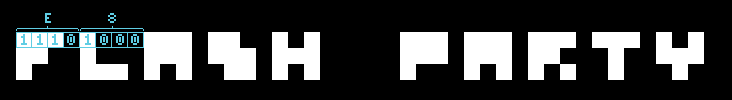
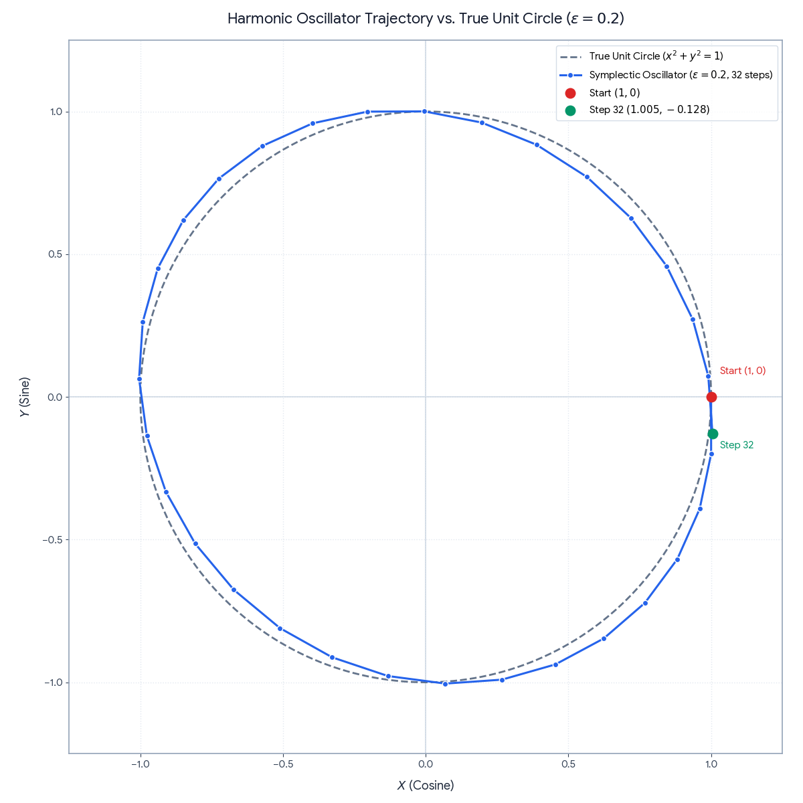
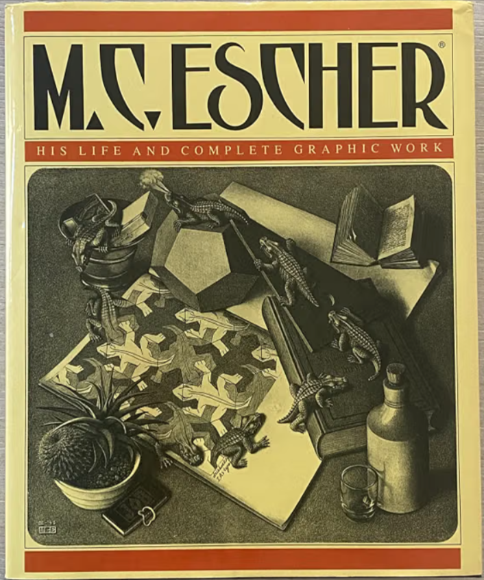
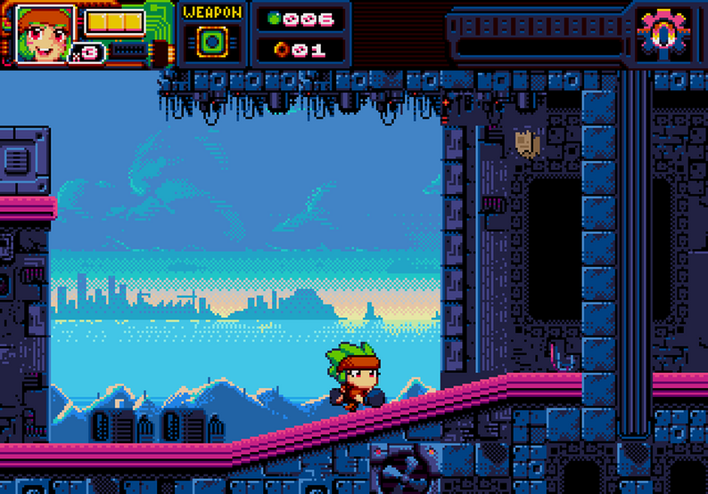
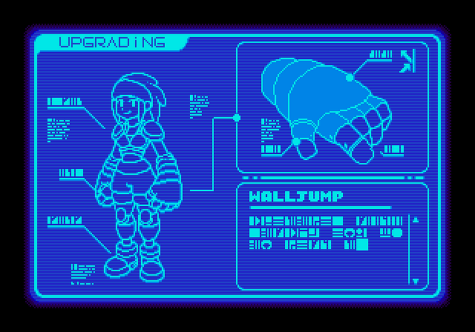

**Contents**

*tech*

- Using AI for demo-making
- Computing Sines and Cosines with a Harmonic Oscillator in Size Coding
- New SEGA game releasing soon

*art*

- The Regular Division of the Plane


## Using AI for demo-making


This past weekend we had the FlashParty demoscene party held in Ciudad Universitaria. Every year I try to present something at the party, usually an MSDOS 256 byte intro. This year I was able to create an entry I'm happy about. For the first time I used AI to help me with the coding process. In these notes I will talk about how I created the entry and how I used AI to improve the code.

First let's talk about the effect: parallax scrolling. Not sure if this effect is new but I fell in love with the effect as implemented in the demo "ReMODed" demo by **7dump** & **SandS**: [https://www.pouet.net/prod.php?which=105924](https://www.pouet.net/prod.php?which=105924). In that demo there is beautiful parallax scroll effect with some superposed animations. Here's a screenshot from the video:


I knew that I couldn't reproduce all the things that were going on in the demo in 256 bytes but I thought that the basic parallax effect I would. So the first step was to understand how it was made. Fortunately the code for the demo was available so I downloaded it and started looking at it. The code is a mixture of Pascal and Assembly. It was in a single file which made it easier but it was an elaborate effect: it did some non-trivial palette creation code and it was not simple for me to follow it. So here is where I turned to AI for the first time: 'please exaplain how this code works' basically to *Claude* and after a couple of minutes he produced a detailed explanation of all the effects that were going on in this scene. I asked it to specifically focus on the parallax scroll and ignore the other things going on (the 'reflection' or the animated characters that appeared). After a few iterations it had created an `.html` version of the effect with a very detailed explanation. You can look at it [here](/assets/files/2026-11-02/ps.html).

From the super complete explanation that *Claude* produced I understood how I could implement this effect. I would basically set up a camera in the \(x-z\) plane and would trace a ray and count which layers the ray would cross. Using 4 bits to represent which layer the ray had crossed I would compute the color. Here's a picture of how I would calculate the intersections:

From this I went to ShaderToy to do an implementation of this idea. After a day or two I had a ShaderToy version which more or less replicated the effect. Using the same palette that *Claude* determined from the source code of the demo it looked surprisingly good. Even better: the algorithm was quite simple so I was pretty sure I would be able to make it work in 256 bytes or less.

```c
void mainImage( out vec4 fragColor, in vec2 fragCoord )
{
    // Normalized pixel coordinates (from 0 to 1)
    vec2 uv = fragCoord/iResolution.xy;
    
    int x = int(uv.x * 320.) - 160;
    int y = int(uv.y * 240.);
    int idx;
    const vec3 palette[] = vec3[](
     vec3(0., 0., 0.),
     vec3( 0./63., 28./63., 28./63.), // l0
     vec3( 0./63., 42./63., 42./63.), // l1
     vec3( 0./63., 63./63., 63./63.), // l0+l1
     
     vec3(42./63., 0./63.,   0./63.), // l2
     vec3(32./63., 32./63., 32./63.), // l0+l2
     vec3(40./63., 40./63., 40./63.), // l1+l2
     vec3(45./63., 63./63., 63./63.), // l0+l1+l2  
     
     vec3(28./63., 0./63.,  63./63.), // l3  
     vec3(31./63., 31./63., 63./63.), // l0+l3
     vec3(31./63., 39./63., 63./63.), // l1+l3
     vec3(31./63., 63./63., 63./63.), // l0+l1+l3
     
     vec3(63./63.,  0./63., 31./63.), // l2+l3
     vec3(63./63., 31./63., 63./63.), // l0+l2+l3
     vec3(63./63., 45./63., 63./63.), // l1+l2+l3
     vec3(63./63., 63./63., 63./63.) // l1+l2+l3+l4
    );
    
    vec3 col;
    int d = 16;
    int bitmap[] = int[](        
        0x8e, 0xa6, 0xa0, 0x8a, 0xa4, 0x40, 
        0xc8, 0xee, 0xe0, 0xee, 0xc4, 0xe0,
        0xe8, 0xec, 0xa0, 0xee, 0xee, 0xa0
    );

    int x1 = (-2*iFrame % 4096) - 3000;
    int x2 = x;
    int size = 32;
    idx = 0;
    int row = y / size;
    if (row >= 2 && row < 5) {
        for (int i = 0; i < 4; i++) {
            int ofx = x2 - x1;
            if (ofx > 0) {
              ofx /= size;
              int pos = ofx / 8;
              int bit = ofx % 8;
              if (pos < 6 && ((0x80>>bit) & bitmap[6*(row-2)+pos]) != 0) {
                idx += (1 << i);
              }
            }
            x2 += x/8;
        }      
    }

    // Output to screen
    fragColor = vec4(palette[idx],1.0);
}
```

To minimize the size of the data needed for the text I used the following 3 line font to spell 'Flash Party'. With this limitation all the information for the bitmapped text fitted in 18 bytes (6 bytes per row). Each byte holds the bitmap pattern for 2 characters. Each character is 4 bits wide (so the font is 4x3).



The bitmap + palette took in total 18+16=34 bytes. I implemented the algorithm in assembly and the I had a 201 byte version. It worked but had a lot of issues. It was, as I usually do, based off the **memories** demo  by Hellmood. I usually take the bare-bones structure: timer code and Rrrola trick to get x,y coordinates and then the code to render the image. It had several problems: the animation wasn't very smooth and I had to use a lot of cycles in DosBOX to get something decent. Also there where a lot of artifacts (bugs) related to how I was doing things. This is when I turned to *Claude* to help me debug these issues. I have the full conversation with *Claude* logged on a file in the repo which you can go through. This really saved a lot of debugging for me. One problem I usually have is that debugging this type of code is very time-consuming. I use `DEBUG.COM` but it's very hard to add breakpoints because you need to add the breakpoint but break after many iterations. Anyway, using *Claude* really helped fix two or three bugs that were non-trivial.

Also to make the demo run better and use less CPU I realized that I only need to calculate 3 horizontal lines as the lines below each are basically a copy. That greatly reduced the CPU usage of the demo as I would calculate the colors for one line and then copy those 31 more lines! This insight was very important to reduce the cost of rendering a frame.

Once I had a smooth and bug-free version I went on to reduce the size as much as I could to be able to fit some music. I reduced it considerably but at one point I became curious to see how much more the code could be reduced. That's when I turned to *Claude* again. What I would do is ask it to generate a new version and tell me how much smaller it could do it without modifying my code. Once I wasn't able to reduce it any more I eventually did peek at the code and used some of it's optimizations. Basically the ones I understood right away. I left out things that where not obvious to me. I also learned a couple of valuable lessons about 80x86 assembly that will be useful for future code. Look at **Appending I** for some of them.

### Music

The music in the demo turned out nicely so I'll describe how it works in a bit of detail. The main code executes after rendering a frame and is as follows:

```nasm
  ; Music
  mov si, music
  test bp, 0x07
  jnz skip_play

ch1:
  ; silence ch1 and set fixed volume for ch2
  mov byte [si + 2 + 5], 0      ; ch1
  mov byte [si + 5 + 5], 90     ; ch2

  ; pattern 1
  rol byte [si + 6 + 5], 1
  jc skipmute1

  ; mute ch1
  mov byte [si + 2 + 5], 0

  ; use pattern 1 to gate the synth channel (ch0)
  xor byte [si + 4], 0x7f

skipmute1:
  rol byte [si + 7 + 5], 1
  jc skipmute2

  ; mute ch 2
  mov byte [si + 5 + 5], 0

skipmute2:
  ; switches instruments of ch1 and ch2
  xor byte [si + 1 + 5], 1
  xor byte [si + 4 + 5], 1

playmidi:
  mov dx, 0x330
  mov cl, 6 + 5
  rep  outsb
  inc dx
  outsb

  ; increase volume of ch1
incvol:
  inc [ch1+3]

  ; other code below
  ; ...

music:
  ; synth channel
  db 0xc0  ; change instrument on channel 3
  db 53    ; Instrument: https://en.wikipedia.org/wiki/General_MIDI#Sound_Effects
  db 0x90  ; play note on channel 10
  db 55    ; note number 55
  db 127   ; set volume to 127 but it will be gated

  ; Drum channel
  db 0x99   ; play note on channel 10 (drums)
  db 40
  db 110    ; play with volume = 127
  db 0x99   ; play note on channel 10 (drums)
  db 62
  db 80    ; play with volume = 127

pattern:
  db 0b10011000 ; pattern 1
  db 0b01101100 ; pattern 2
```

Here's whats happening:
- We have 3 "channels" playing: a synth pad (ch0) and two drum channels (ch1 and ch2)
- ch0 has the "Oohs" MIDI pad see [here](https://en.wikipedia.org/wiki/General_MIDI#Ensemble)
- ch1 and ch2 toggle instrument on every beat. ch1 switches between a kick and a snare while ch2 switches between a high and a low conga sounds.
- ch1 starts with volume 0 and fades in on each frame by 1 so the kick and drum gives it some variation
- pattern 1 also toggles the volume of the ch0 pad which gives it some variation
- since I had some bytes to spare I also increase the pitch of the ch0 pad midway through the demo

### Apendix I

Some **80x86** lessons:

- When you have instructions with operators like `[SI]`  o `[DI]` but you need to add an offset to it you don't need to do two instructions:

```nasm
add si, 100
mov al, [si]
```

Instead, if the number is a constant you can do it within the instruction:

```nasm
mov al, [si + 100]
```

This is obvious if you are experienced or do a lot of 80x86 coding but I used this in several places to reduce code size.

- **Bit test** for this demo I at one point I had to test the bit in memory to determine if it was `0` or `1`. I basically had the offset in bits so I had to divide / 8 to get the byte offset and do modulo 8 to determine the bit within that byte. I didn't know of `BT` which does precisely this but in a single instruction! So instead of this:

```nasm
mov si, fptext
mov cx, ax            ; Save position for later use
shr ax, 3             ; AX / 8 (position / 8)
xchg bx, ax           ; Save byte offset into BX
xor ah, ah            ; Clear AH
mov al, byte [si+bx]  ; Get byte at fptext + offset
and cl, 0x07          ; position % 8
shl al, cl            ; shift out bit
jnc .skip

```
I could replace with this (!!!!!):

```nasm
mov si, ax
bt [si+fptext], ax
jnc .skip
```

And I had to flip the bits of the text because of where the offset is. But this reduced greatly the size!

- **short else trick** I just heard this trick in the Rrřola's talk. I didn't use it but many times I could have used it so I'll write it for my future me. The trick is useful when you haven `if/else` where the `else` is very short (at most 4 bytes). You basically check for the else in the loop and jump to it if the condition is met. If the condition is not met you execute the long code. At the end of that code you would need to jump the else code. But if it's short what you do is just store the opcode of a `mov` instruction which moves those 4 bytes into a random/not used register

- **Self modifying code is slow** Midway through the development I tested the code on an Athlon 1500 MHz computer expecting it to run too fast. Not the case. I was baffled so I asked *Claude* and the main reasons where 2. One was self modifying code. Instead of using a register I would change part a byte in the middle of the code on each iteration. Turns out DosBOX doesn't penalize it but modifying the code has the unfortunate side-effect that the processor has to ditch it's instruction cache which make the code run muuuch slower. Changing this considerably increased the speed but not as much as I had hoped. The reason was the second lesson:

- **Video RAM is -slow-** The resulting demo would only calculate 3 rows and would copy the rest from the previous lines by reading from Video RAM. This, turns out is very slow. The correct way would be to use regular RAM as a buffer to generate the video and then copy from there to RAM. Unfortunately this will probably increase the size of the code so I couldn't implement this. I will do a version that uses this method just to test how fast the code can actually run on real hardware.

### Links

- [Pouet entry](https://www.pouet.net/prod.php?which=105924) - Pouet entry for the ReMODed demo.
- [Demozoo entry of Oohs](https://demozoo.org/productions/400197/) - This is the entry of my demo @Demozoo.
- [ShaderToy version](https://www.shadertoy.com/view/sX3SDf) - This is the Shader toy version I did of the main effect
- [Magic of 256-byte x86 intros - Jan 'Rrřola' Kadlec - Demobit 2017](https://www.youtube.com/watch?v=WbWYBE9vjdk) - A great talk by Rrřola on size coding.
- [Řrřola - Magic of 256-byte x86 intros - part 2. (Demobit 2018)](https://www.youtube.com/watch?v=51BOp5Pi4mU) - Another size coding talk by Rrřola.


## Computing Sines and Cosines with a Harmonic Oscillator in Size Coding

Rrřola mentioned the 'harminic oscillator' trick on one of this talks. I asked Gemini to explain to me how it works and this is what it came back with. Pretty neat.

To compute sines and cosines in size coding (like 256-byte or 4KB intros), you can use a **discrete harmonic oscillator**, often called the **Minsky circle algorithm** or **magic circle algorithm**. Instead of calling expensive `sin()` or `cos()` instructions or storing lookup tables, you generate waves iteratively using just two additions and two multiplications per step.

### How the Math Works

A continuous harmonic oscillator is governed by the differential equation:

$$x'' = -\omega^2 x$$

When discretized using a modified Euler method (specifically, a **symplectic Euler integrator**), the update equations become:

$$x_{n+1} = x_n + \epsilon y_n$$

$$y_{n+1} = y_n - \epsilon x_{n+1}$$

Notice that the second line uses the **newly updated** \(x_{n+1}\) rather than the old \(x_n\) This small change keeps the determinant of the transformation matrix equal to \(1\)

$$\det \begin{pmatrix} 1 & \epsilon \\ -\epsilon & 1 - \epsilon^2 \end{pmatrix} = (1 - \epsilon^2) - (-\epsilon^2) = 1$$

Because the determinant is \(1\) area (and energy) is preserved, which stops the wave from spiraling outward or decaying to zero.

* **Initial state:** Set \(x_0 = 1\) (cosine) and \(y_0 = 0\) (sine) to start at angle \(theta = 0\)
* **Step size (\(\epsilon\)** Controls the frequency. For small angles, \(\epsilon \approx \frac{2\pi}{N}\) where \(N\) is the number of steps per full circle. More precisely:
  $$\epsilon = 2 \sin\left(\frac{\pi}{N}\right)$$
* **Phase shift:** Because the updates are staggered by half a step, \(x\) and \(y\) are slightly off from a true \(90^\circ\) (\(\frac{\pi}{2}\) radians) phase difference by \(\frac{\epsilon}{2}\) radians. For small \(\epsilon\) this error is visually unnoticeable.

### Size-Coding Implementations

### 1. C / GLSL (4KB Intros)

In shader or C-based intros, the algorithm reduces to two lines inside a loop. You can often fold the $\epsilon$ multiplication into bit-shifts if you work with fixed-point integers.

```c
// Floating point (e.g., GLSL or C)
float c = 1.0, s = 0.0;
float eps = 0.01; // Frequency step

for (int i = 0; i < 1000; i++) {
    c += eps * s;
    s -= eps * c; // Uses the new 'c'
    // Use 'c' (cos) and 's' (sin) here
}
```

### 2. Fixed-Point / Bit-Shift Trick (256-Byte Intros)

In extreme size coding (like x86 assembly), floating-point constants take up precious bytes. If you choose \(epsilon = 2^{-k}\) multiplication becomes a simple arithmetic bit-shift (`sar`), eliminating the need for any constants or FPU/SSE instructions.

```c
// Integer fixed-point version (no floats, no multiplies)
int c = 1 << 16; // Initial radius = 65536
int s = 0;

for (int i = 0; i < 1000; i++) {
    c += s >> 6; // eps = 1/64 = 2^-6
    s -= c >> 6;
}
```

### 3. x86 Assembly (16-bit / 32-bit DOS Intros)

Using 16-bit registers (`ax` for cosine, `bx` for sine), the entire sine/cosine generator takes only **8 bytes** of machine code:

```nasm
; Initial setup: AX = 0x4000 (radius), BX = 0
loop_start:
    mov dx, bx      ; Copy sin
    sar dx, 6       ; dx = sin / 64
    add ax, dx      ; cos += sin / 64

    mov dx, ax      ; Copy updated cos
    sar dx, 6       ; dx = cos / 64
    sub bx, dx      ; sin -= cos / 64
    ; Repeat loop
```


### Key Trade-offs & Tips

- **Stability vs. Precision**: Because the symplectic update preserves area, the trajectory forms a slightly tilted ellipse rather than a perfect circle. As long as \(\epsilon < 2\) the orbit remains completely stable and will never blow up to infinity, even after millions of iterations.
- **Amplitude Scaling:** The peak amplitude of \(y\) (sine) is slightly smaller than \(x\) (cosine) by a factor of:
  $$\sqrt{1 - \frac{\epsilon^2}{4}}$$
  Keep \(\epsilon\) small (e.g., \(\epsilon \le 0.1\) or bit-shifts of \(k \ge 4\) so the ellipse looks indistinguishable from a circle.
- **No Random Access:** Unlike `fsin`/`fcos` or Taylor series approximations, you cannot jump to an arbitrary angle \(\theta\) This method works best for drawing circles, spirals, waveforms, or driving continuous time-based animations.


---

## The Regular Division of the Plane

In 1957 the De Roos Foundation, a private press producing limited editions for members only, commissioned Escher to write an essay on his hobby of the regular division of the plane. A year later the essay was published in book form under the title of Regelmatige vlakverdeling; it was illustrated by woodcuts which Escher had especially made for it.

Unfortunately the only text I know of, of this book is included in this book:



I want to do two things:
- **Create a physical version of the book**. For a long time I've wanted to get into bookbinding and I think printing this book, it's illustrations and binding it to have a physical version is a fun project to tackle.
- **Create an ebook** This I've already done. I scanned my copy of the book and used Claude to locally run tesseract 5 to get a text version, clean up the version and create a Markdown version which it later converted to an ebook. I have private Github repository of this. If you want to access it ping me (🤫)

### Links

- [The Regular Division of The Plane at the ‘De Roos’ foundation](https://www.escherinhetpaleis.nl/en/about-escher/escher-today/the-regular-division-of-the-plane-at-the-de-roos-foundation) - An article describing the history of the book.
- [Escher Today](https://www.escherinhetpaleis.nl/en/about-escher/escher-today) - This is a fascinating blog which has many articles relating to Escher. Must read for all fans.

---


## New SEGA game releasing soon - Phantom gear






In a few days an Argentinean company will release a new game for the Sega Genesis console in physical format! They have released a demo version in [itch.io](https://bitsrulegames.itch.io/phantom-gear-demo) and it looks very promising.

- [Kickstarter campaign](https://www.kickstarter.com/projects/megacatstudios/phantom-gear-for-the-sega-genesis-mega-drive) - The original campaign that run in July 2019
